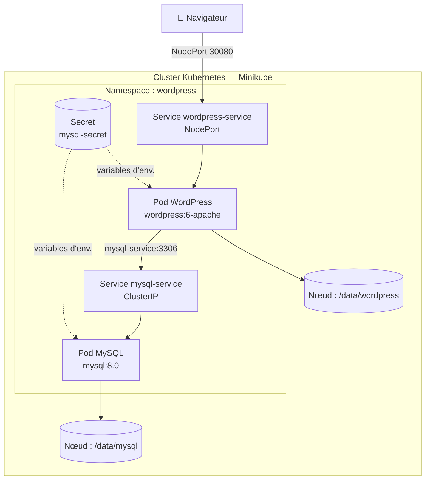

# ☸️ WordPress sur Kubernetes — déploiement avec des manifests YAML


> **En bref :** j'ai déployé WordPress et sa base MySQL sur un cluster Kubernetes en écrivant **moi-même chaque manifest YAML**, sans Helm. L'objectif était de comprendre ce qu'un chart Helm génère : Deployments, Services, Secret, volumes, sondes de santé. J'ai aussi vérifié que les données survivent à la destruction des pods.

**Auteur :** Cathalina — [rnvscathalina22@gmail.com](mailto:rnvscathalina22@gmail.com)

---

## 📌 Sommaire

1. [Objectif](#-objectif)
2. [Architecture](#-architecture)
3. [Compétences démontrées](#-compétences-démontrées)
4. [Structure du dépôt](#-structure-du-dépôt)
5. [Les manifests, un par un](#-les-manifests-un-par-un)
6. [Déploiement et résultats](#-déploiement-et-résultats)
7. [Test de persistance](#-test-de-persistance)
8. [Problèmes rencontrés et solutions](#-problèmes-rencontrés-et-solutions)
9. [Lancer le projet](#-lancer-le-projet)
10. [Pistes d'amélioration](#-pistes-damélioration)

---

## 🎯 Objectif

| Exigence de l'énoncé | Réalisation |
|---|---|
| Deployment MySQL avec un seul réplica | `03-mysql-deployment.yaml` — `replicas: 1` |
| Service ClusterIP pour MySQL | `04-mysql-service.yaml` — `mysql-service:3306` |
| Deployment WordPress avec les variables de connexion | `05-wordpress-deployment.yaml` — variables `WORDPRESS_DB_*` lues depuis un Secret |
| Données WordPress sur un volume monté dans `/data` du nœud | volume `hostPath` → `/data/wordpress` |
| Service NodePort pour exposer WordPress | `06-wordpress-service.yaml` — port `30080` |
| Utiliser des manifests, pas Helm | 6 fichiers YAML écrits à la main |

---

## 🏗 Architecture



**Points clés :**
- **Isolation** : tous les objets sont regroupés dans le namespace `wordpress`.
- **La base n'est jamais exposée** : MySQL est accessible uniquement depuis l'intérieur du cluster (ClusterIP).
- **Découverte par DNS** : WordPress joint MySQL par le nom du Service (`mysql-service`), jamais par une IP de pod, puisque celles-ci changent à chaque redémarrage.
- **Une seule source de vérité pour les mots de passe** : le Secret est lu par les deux applications.
- **Persistance** : les données de MySQL et de WordPress sont stockées sur le nœud, hors du cycle de vie des pods.

---

## 💡 Compétences démontrées

| Domaine | Ce que j'ai mis en pratique |
|---|---|
| **Objets Kubernetes** | Namespace, Secret, Deployment, Service (ClusterIP et NodePort) |
| **Configuration** | `envFrom` + `secretRef`, `secretKeyRef`, `WORDPRESS_CONFIG_EXTRA` |
| **Stockage** | Volumes `hostPath` et persistance des données |
| **Fiabilité** | Readiness probes, requests/limits de ressources, stratégies `Recreate` et `RollingUpdate` |
| **Réseau** | DNS interne du cluster, exposition par NodePort, tunnel Minikube |
| **Debugging** | Diagnostic avec `kubectl describe` (Events), `kubectl logs`, `minikube ssh` |
| **Infrastructure as Code** | Tout le déploiement est décrit dans des fichiers versionnés |

---

## 📂 Structure du dépôt

```
wordpress-manifests/
├── README.md
├── 01-namespace.yaml
├── 02-mysql-secret.yaml
├── 03-mysql-deployment.yaml
├── 04-mysql-service.yaml
├── 05-wordpress-deployment.yaml
├── 06-wordpress-service.yaml
└── images/                       # Captures d'écran
```

Les fichiers sont **numérotés dans l'ordre de dépendance** : `kubectl apply -f .` les applique dans l'ordre alphabétique, donc le namespace et le Secret sont créés avant les Deployments qui en ont besoin.

---

## 📄 Les manifests, un par un

### 1. Namespace

Un « dossier » dans le cluster pour isoler le projet. Il permet aussi de tout supprimer en une commande.

### 2. Secret

```yaml
stringData:
  MYSQL_ROOT_PASSWORD: rootpassword
  MYSQL_DATABASE: wordpress
  MYSQL_USER: wordpress
  MYSQL_PASSWORD: wordpresspassword
```

Les identifiants sont centralisés ici, au lieu d'être écrits en clair dans les Deployments. `stringData` permet d'écrire les valeurs lisiblement, et Kubernetes les encode lui-même en base64.

> ⚠️ **Le base64 n'est pas un chiffrement.** Ce Secret est versionné ici parce qu'il s'agit d'un exercice. En production, il ne serait pas poussé sur Git : on utiliserait Sealed Secrets, External Secrets ou Vault.

### 3. Deployment MySQL

| Élément | Choix et justification |
|---|---|
| `replicas: 1` | Une seule instance, comme demandé. Plusieurs pods MySQL sur le même dossier corrompraient les données |
| `strategy: Recreate` | Lors d'une mise à jour, l'ancien pod est arrêté **avant** le démarrage du nouveau. Deux MySQL n'écrivent donc jamais en même temps dans `/data/mysql` |
| `envFrom: secretRef` | Charge toutes les clés du Secret. Leurs noms (`MYSQL_*`) correspondent exactement à ce qu'attend l'image MySQL |
| Volume `hostPath` `/data/mysql` | Les articles, comptes et réglages survivent à la recréation du pod. Ce n'était pas demandé pour MySQL, mais sans ça le volume de WordPress ne servirait à rien : son contenu serait conservé mais la base serait vide |
| `readinessProbe` (`mysqladmin ping`) | Le Service n'envoie du trafic au pod que lorsque MySQL répond vraiment |
| `resources` | Mémoire et CPU réservés, mémoire plafonnée pour protéger le nœud |

### 4. Service MySQL — ClusterIP

Donne un nom DNS stable, `mysql-service`, et une IP fixe au pod MySQL, **à l'intérieur du cluster uniquement**. La base n'est pas joignable depuis l'extérieur.

### 5. Deployment WordPress

Les variables de connexion, lues dans le Secret :

| Variable | Source |
|---|---|
| `WORDPRESS_DB_HOST` | `mysql-service:3306`, le nom du Service |
| `WORDPRESS_DB_NAME` | clé `MYSQL_DATABASE` du Secret |
| `WORDPRESS_DB_USER` | clé `MYSQL_USER` du Secret |
| `WORDPRESS_DB_PASSWORD` | clé `MYSQL_PASSWORD` du Secret |

Ici, `secretKeyRef` est utilisé clé par clé, car l'image WordPress attend des noms différents (`WORDPRESS_DB_*`). Les mots de passe ne sont écrits qu'à un seul endroit, et MySQL comme WordPress utilisent forcément les mêmes.

Le dossier `/var/www/html` (fichiers, thèmes, plugins, médias) est monté sur **`/data/wordpress` du nœud**, comme demandé.

Le Deployment garde la stratégie par défaut, **`RollingUpdate`** : à chaque mise à jour, le nouveau pod est démarré et validé **avant** l'arrêt de l'ancien. Il n'y a donc pas d'interruption de service.

### 6. Service WordPress — NodePort

```
Navigateur ──► nœud:30080 ──► Service:80 ──► pod WordPress:80
              nodePort         port          targetPort
```

---

## 🚀 Déploiement et résultats

```bash
kubectl apply -f .
kubectl get all -n wordpress
```


Accès à WordPress (spécificité de Minikube avec le driver Docker sur macOS, voir [problème n°3](#3-le-nodeport-nest-pas-joignable-directement-sur-macos)) :

```bash
minikube service wordpress-service -n wordpress --url
```

La page d'installation de WordPress prouve que la connexion à MySQL fonctionne :


Le tableau de bord après l'installation :


---

## 💾 Test de persistance

**1. Les données sont bien sur le nœud, dans `/data` :**

```bash
minikube ssh -- ls /data
minikube ssh -- ls /data/wordpress
```


**2. Suppression de tous les pods :**

```bash
kubectl delete pod -n wordpress --all
kubectl get pods -n wordpress -w
```

Kubernetes recrée automatiquement deux nouveaux pods, avec de nouveaux noms, pour respecter le nombre de réplicas demandé par les Deployments :


**3. Résultat :** l'article créé avant la suppression est toujours là.


---

## 🔧 Problèmes rencontrés et solutions

### 1. `kubectl` pointait vers un ancien cluster AKS supprimé

**Symptôme :** `kubectl get nodes` renvoyait `no such host` pour une adresse `*.azmk8s.io`.

**Diagnostic :** `kubectl config get-contexts` montrait que le contexte actif était un ancien cluster Azure.

**Solution :** `kubectl config use-context minikube`, puis `minikube delete && minikube start --driver=docker`, car le conteneur du nœud Minikube n'existait plus.

### 2. Le pod WordPress oscillait entre « prêt » et « pas prêt »

**Symptôme :** le pod passait régulièrement de `1/1` à `0/1`, sans redémarrer.

**Cause :** le délai par défaut de la readiness probe est de **1 seconde**, et WordPress dépassait parfois ce délai.

**Solution :** `timeoutSeconds: 5` et `failureThreshold: 3`. Une lenteur isolée ne retire plus le pod du Service.

### 3. Le NodePort n'est pas joignable directement sur macOS

**Cause :** avec le driver Docker, le nœud Minikube tourne dans un conteneur, et son IP n'est pas routable depuis macOS.

**Solution :** `minikube service ... --url` ouvre un tunnel local vers le NodePort. Le Service reste bien de type NodePort, conformément à l'énoncé : le tunnel n'est qu'un moyen d'y accéder depuis le Mac.

### 4. Le site devenait inaccessible après un redémarrage du tunnel

**Symptôme :** `ERR_CONNECTION_RESET` dans le navigateur et pod WordPress bloqué en `0/1`.

**Diagnostic :** les Events de `kubectl describe pod` montraient :
```
Readiness probe failed: Get "http://10.244.0.5:54741/": connection refused
```
WordPress enregistre l'adresse du site à l'installation, ici `127.0.0.1:54741`, le port du tunnel à ce moment-là. Il redirigeait ensuite **toutes** les requêtes vers ce port, y compris celles de la sonde de Kubernetes. La sonde échouait, le pod était marqué « pas prêt », et le Service n'avait plus aucun pod vers qui envoyer le trafic.

**Solution :** WordPress utilise désormais l'adresse par laquelle il est appelé :
```yaml
- name: WORDPRESS_CONFIG_EXTRA
  value: |
    define('WP_HOME', 'http://' . $_SERVER['HTTP_HOST']);
    define('WP_SITEURL', 'http://' . $_SERVER['HTTP_HOST']);
```
Le site fonctionne maintenant quel que soit le port du tunnel, et la sonde passe.

**Ce que j'en retiens :** une readiness probe en échec ne fait pas redémarrer le pod, elle le **retire du Service**. Le symptôme apparaît côté réseau alors que la cause est applicative.

---

## ▶️ Lancer le projet

**Prérequis :** Docker Desktop, Minikube et kubectl.

```bash
git clone https://github.com/CathalinaRanaivoarison/wordpress-manifests.git
cd wordpress-manifests

minikube start --driver=docker
kubectl apply -f .
kubectl get pods -n wordpress -w      # attendre 1/1 Running, puis Ctrl + C

minikube service wordpress-service -n wordpress --url
```

Sur un cluster dont les nœuds sont directement joignables (Linux, VM, cloud) : `http://<IP-du-nœud>:30080`.

**Tout supprimer :**
```bash
kubectl delete namespace wordpress
minikube ssh -- sudo rm -rf /data/mysql /data/wordpress   # optionnel : efface les données
```

---

## 🔮 Pistes d'amélioration

- **PersistentVolume + PersistentVolumeClaim** au lieu de `hostPath`. `hostPath` lie les données à **un seul nœud** : sur un cluster à plusieurs nœuds, un pod replanifié ailleurs ne retrouverait pas ses données.
- **StatefulSet pour MySQL**, l'objet prévu pour les applications avec état (identité stable, volume dédié).
- **Gestion sécurisée des secrets** : Sealed Secrets, External Secrets Operator ou Vault.
- **Ingress** avec un nom de domaine et HTTPS, plutôt qu'un NodePort.
- **Liveness probes**, en plus des readiness probes, pour redémarrer un conteneur bloqué.
- **Plusieurs réplicas WordPress** avec un stockage partagé (`ReadWriteMany`) et un HorizontalPodAutoscaler.
- **Kustomize** pour gérer plusieurs environnements (dev, prod) à partir des mêmes manifests.
- **Versions d'images figées** (`wordpress:6.9.4-apache`) pour des déploiements parfaitement reproductibles.

---

## 📬 Contact

**Cathalina** — [rnvscathalina22@gmail.com](mailto:rnvscathalina22@gmail.com)